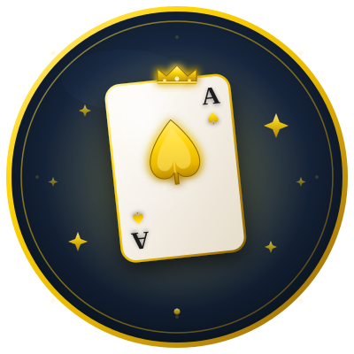

# 📚 مستندات پروژه Hokm Pro | Documentation

<div align="center">
  
  <br>
  <i>راهنمای کامل فنی و توسعه‌دهندگان</i>
</div>

---

به مستندات رسمی بازی «حکم حرفه‌ای» (نسخه ۷.۰.۰) خوش آمدید.

این پوشه شامل اطلاعات فنی، راهنمای توسعه‌دهندگان، تاریخچه تغییرات و قوانین مربوط به پروژه است تا هر توسعه‌دهنده‌ای بتواند به راحتی با این پروژه کار کند.

## 📑 فهرست مستندات

برای مشاهده هر بخش، روی لینک آن کلیک کنید:

- 🏗️ **[معماری پروژه (ARCHITECTURE.md)](/Docs/ARCHITECTURE.md):** توضیح دقیق ساختار فایل‌ها، نحوه کارکرد بخش‌های مختلف و ارتباط بین فرانت‌اند و بک‌اند.
- ⚙️ **[مستندات فنی و API (API.md)](/Docs/API.md):** توضیح توابع اصلی، رویدادها (Events)، ماژول‌ها و کلاس‌های جاوااسکریپت.
- 📝 **[تاریخچه تغییرات (CHANGELOG.md)](/Docs/CHANGELOG.md):** لیست نسخه‌های منتشر شده، ویژگی‌های اضافه شده و باگ‌های رفع شده در هر نسخه.
- 🔒 **[سیاست حفظ حریم خصوصی (PRIVACY.md)](/Docs/PRIVACY.md):** اطلاعات مربوط به نحوه ذخیره‌سازی داده‌های کاربران (مورد نیاز برای مایکت و کافه‌بازار).
- 🤝 **[راهنمای مشارکت (CONTRIBUTING.md)](/Docs/CONTRIBUTING.md):** قوانین و استانداردها برای توسعه‌دهندگانی که می‌خواهند به پروژه کمک کنند.

---

## 🚀 نگاه کلی به پروژه (Overview)

**Hokm Pro** یک بازی حکم ایرانی کامل، مدرن و حرفه‌ای است که با استفاده از تکنولوژی‌های وب (Vanilla JS) و پایتون (Flask + Socket.io) از صفر ساخته شده است. این بازی هم به صورت آفلاین (با هوش مصنوعی) و هم به صورت آنلاین (با دوستان) قابل اجرا است.

در نسخه **۷.۰.۰**، رابط کاربری بازی به طور کامل بازطراحی شد و به سطح کیفی بازی‌های AAA موبایلی (با تم لوکس مخملی-طلایی) ارتقا یافت. تمام آیکون‌ها به صورت اختصاصی با SVG طراحی شده‌اند و گرافیک بازی حالا حس یک کازینو VIP را منتقل می‌کند.

---

## 🎨 ویژگی‌های نسخه ۷.۰.۰

- **🎨 طراحی لوکس (Luxury UI):** پالت رنگی مخملی-طلایی، افکت‌های شیشه‌ای (Glassmorphism)، درخشش طلایی (Golden Glow) و سایه‌های 3D.
- **🖼️ ۲۲ آیکون SVG اختصاصی:** تمام آیکون‌های بازی (سکه، جم، تاج، جام، تنظیمات، آواتار و ...) به صورت وکتور و با طراحی اختصاصی.
- **🎬 ۵۰+ انیمیشن حرفه‌ای:** انیمیشن‌های روان برای کارت‌ها، نوبت‌ها، پیروزی و ری‌اکشن‌ها.
- **💎 ۵ تم رنگی لوکس:** طلایی، زمرد، اقیانوس، سلطنتی، یاقوت.
- **🃏 ۵ طرح کارت:** کلاسیک، تاریک، چوبی، کارتونی، نئون.
- **🌌 ۵ پس‌زمینه:** گرادیانت، چوبی، شطرنجی، شبانه، کریستالی.
- **📱 ریسپانسیو کامل:** بهینه برای ۱۲ بریک‌پوینت از موبایل تا دسکتاپ بزرگ.

---

## 🛠️ تکنولوژی‌های اصلی

| بخش | تکنولوژی‌ها |
|------|-------------|
| **فرانت‌اند (Frontend)** | HTML5, CSS3, Vanilla JavaScript (ES6+) |
| **طراحی و انیمیشن** | CSS Grid, Flexbox, Custom Animations, Web Audio API, Canvas API |
| **آیکون‌ها (Icons)** | SVG (۲۲ فایل اختصاصی) |
| **بک‌اند (Backend)** | Python 3, Flask, Flask-SocketIO |
| **دیتابیس (Database)** | SQLite3 |
| **ابزارها (Tools)** | Git, GitHub |

---

## 📁 ساختار فایل‌های گرافیکی

```text
assets/
├── logo.svg
├── favicon.svg
├── tutorial/
│   ├── step1.svg
│   ├── step2.svg
│   ├── step3.svg
│   └── step4.svg
└── svg/                    # 🆕 آیکون‌های لوکس نسخه ۷.۰
    ├── card-back.svg
    ├── card-front-frame.svg
    ├── card-suits.svg
    ├── chat-icon.svg
    ├── chest-icon.svg
    ├── clover-icon.svg
    ├── coin.svg
    ├── crown-vip.svg
    ├── dark-mode-toggle.svg
    ├── gem.svg
    ├── gift-box.svg
    ├── home-icon.svg
    ├── mail-icon.svg
    ├── medal-icon.svg
    ├── notification-icon.svg
    ├── settings-gear.svg
    ├── shop-icon.svg
    ├── slot-icon.svg
    ├── sound-icon.svg
    ├── target-icon.svg
    ├── trophy.svg
    └── avatar-default.svg
```

---

🎯 نقشه راه (Roadmap)

· ✅ نسخه ۶.۰.۰: انتشار اولیه + بازی آفلاین + آنلاین
· ✅ نسخه ۶.۱.۱: رفع باگ ELO، حذف داده جعلی، توزیع مرحله‌ای
· ✅ نسخه ۶.۳.۰: رفع باگ‌ها، اضافه شدن سیستم دوستان
· ✅ نسخه ۷.۰.۰: بازطراحی کامل UI با تم لوکس مخملی-طلایی + آیکون‌های SVG
· 🔜 نسخه ۷.۱.۰: گردونه شانس، لیگ‌های رقابتی
· 🔜 نسخه ۸.۰.۰: نسخه انگلیسی + انتشار در گوگل پلی

---

<div align="center">
  <i>ساخته شده با ❤️ توسط امیرعلی کامرانی</i>
</div>
