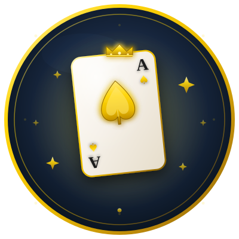

<div align="center">

# 🃏 Hokm Pro | حکم حرفه‌ای

**The Ultimate Persian Hokm Card Game — بازی حکم ایرانی**

[](https://github.com/Amirali-cmyk)
[](https://github.com/Amirali-cmyk)
[](https://github.com/Amirali-cmyk)
[](https://github.com/Amirali-cmyk)
[](https://github.com/Amirali-cmyk)

[](https://opensource.org/licenses/MIT)

</div>

---

<div align="center">
  
  <br>
  <i>ساخته شده با ❤️ توسط امیرعلی کامرانی</i>
</div>

---

## ✨ درباره پروژه (About)

**Hokm Pro** یک بازی حکم ایرانی کامل، مدرن و حرفه‌ای است که با استفاده از تکنولوژی‌های وب (Vanilla JS) و پایتون (Flask + Socket.io) از صفر ساخته شده است. این بازی هم به صورت آفلاین (با هوش مصنوعی) و هم به صورت آنلاین (با دوستان) قابل اجرا است.

---

## 🚀 ویژگی‌های کلیدی (Features)

- 🎮 **بازی آفلاین با AI:** ۴ سطح هوش مصنوعی (آسان، متوسط، سخت، استاد).
- 👥 **بازی آنلاین (Multiplayer):** ساخت اتاق با کد ۶ رقمی و بازی بلادرنگ با دوستان.
- 🪙 **سیستم سکه و اقتصاد بازی:** شروع با ۵۰۰ سکه، جایزه روزانه (۵۰ سکه)، و جایزه در هر دست.
- 📊 **سیستم رتبه‌بندی ELO:** ۷ سطح رتبه‌بندی از مبتدی تا افسانه (مبتنی بر فرمول FIDE).
- 🏆 **جدول امتیازات (Leaderboard):** رقابت در فیلترهای هفتگی، ماهانه و کل.
- 🎖️ **۱۲ دستاورد (Achievements):** باز کردن جوایز و قابلیت‌های جدید.
- 🎨 **شخصی‌سازی کامل:** ۵ تم رنگی، ۵ طرح کارت، ۵ پس‌زمینه، و حالت شب/روز.
- 📼 **پخش مجدد (Replay):** ذخیره و تماشای مجدد بازی‌ها.
- 📤 **اشتراک‌گذاری:** ساخت تصویر نتیجه بازی با Canvas.
- 📱 **طراحی واکنش‌گرا (Responsive):** کاملاً بهینه برای موبایل و دسکتاپ.
- 🌐 **PWA-Ready:** قابلیت نصب روی گوشی به عنوان یک اپلیکیشن.

---

## 🛠️ تکنولوژی‌ها (Tech Stack)

| بخش | تکنولوژی‌ها |
|------|-------------|
| **فرانت‌اند (Frontend)** | HTML5, CSS3, Vanilla JavaScript (ES6+) |
| **طراحی و انیمیشن** | CSS Grid, Flexbox, Custom Animations, Web Audio API, Canvas API |
| **بک‌اند (Backend)** | Python 3, Flask, Flask-SocketIO |
| **دیتابیس (Database)** | SQLite3 |
| **ابزارها (Tools)** | Git, GitHub |

---

## 📁 ساختار پروژه (Project Structure)

```text
hokm-pro/
├── index.html              # نقطه ورود بازی
├── 404.html                # صفحه خطا
├── server.py               # سرور Flask (بخش آنلاین)
├── requirements.txt        # وابستگی‌های پایتون
├── README.md               # مستندات
│
├── assets/                 # آیکون‌ها، لوگو و تصاویر آموزشی
├── css/                    # فایل‌های استایل
│   ├── base.css
│   ├── components.css
│   ├── screens.css
│   ├── themes.css
│   ├── animations.css
│   └── responsive.css
│
└── js/                     # منطق بازی و رابط کاربری
    ├── storage.js          # مدیریت حافظه محلی
    ├── themes.js           # مدیریت تم‌ها
    ├── audio.js            # موتور صدا (Web Audio)
    ├── profile.js          # پروفایل و سیستم ELO
    ├── achievements.js     # دستاوردها
    ├── leaderboard.js      # لیدربورد
    ├── friends.js          # دوستان
    ├── tournament.js       # تورنمنت‌ها
    ├── replay.js           # پخش مجدد
    ├── share.js            # اشتراک‌گذاری
    ├── ai.js               # هوش مصنوعی (AI)
    ├── game.js             # قلب منطق بازی
    ├── ui.js               # رابط کاربری
    ├── settings.js         # تنظیمات
    └── main.js             # راه‌انداز